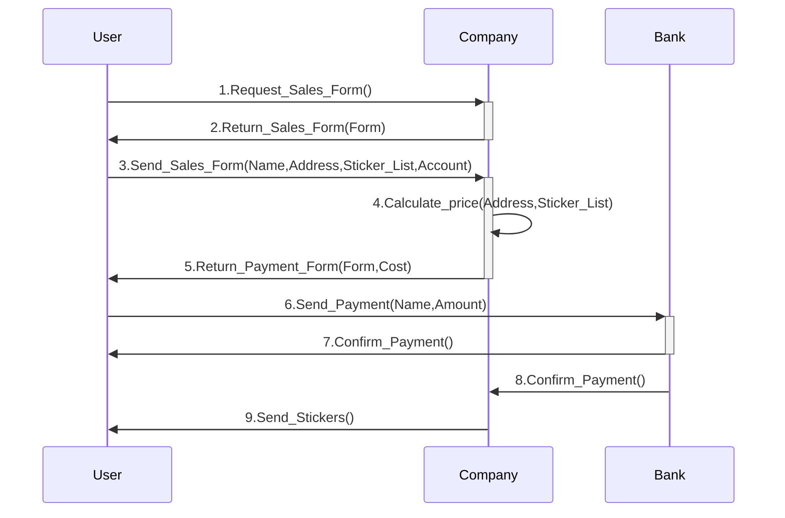

#review2 

- For example, suppose we are missing 4 stickers from our collection and we want to order them from the company that distributes them. On this company's website there is a form to fill in, with data such as our name, address and the numbers of the stickers we need. This is the **format** of the form the company has created with the data it needs in order to provide its service. Once these data have been filled in, the user submits the form and the server, as the **action** associated with this submission, calculates the cost of the service (for example, adding up the cost of each sticker plus the shipping costs to the address provided) and sends it to the user as another form in which they must enter their credit card details (again we see another, different **format** of data that must be filled in). Finally, the user validates the purchase from their banking app and the order reaches the company's sales department, which will send a parcel with the stickers bought by the user. 
- The following figure shows the exchange of messages, their format and their order [^1]

[^1]: the figure shows a simplified exchange.