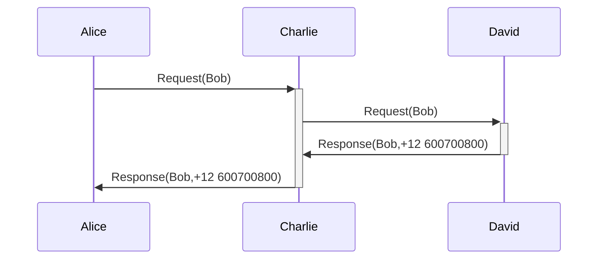
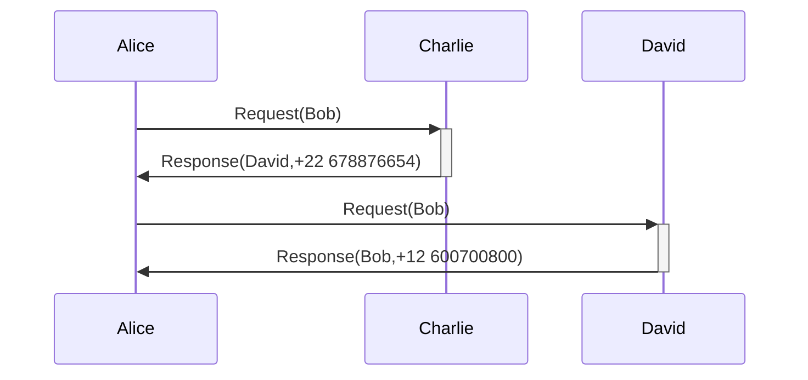

#flashcards/dns 
#review2 

- DNS is reminiscent of a phone contact list: a user, let's call her Alice, usually does not remember the phone number of the person she wants to call, but she does remember their name, for example, Bob. So Alice looks up Bob's phone number in her contact list, which is what her mobile/landline phone actually needs in order to make the call.
- We may ask: what happens if Alice does not have Bob in her contact list? Alice could call Charlie, whom she does have in her contact list, and ask him whether he has Bob's phone number. Two things could happen here:
	- Charlie does have Bob's number, so he gives it to Alice.
	- Charlie does not have Bob's number, but he does have the number of David, who might know it. In this case, two situations may arise:
		- Charlie gives David's name and number to Alice so that she can call him herself (in DNS this is known as iterative service; see [[Types of DNS queries]])
		- Charlie calls David and asks him whether he knows Bob's phone number. At this point, the same circumstances may arise as when Alice called Charlie (in DNS this case is known as recursive service -see [[Types of DNS queries]]-)
- Example where Charlie provides a recursive service [^1]

- Example where Charlie provides an iterative service [^1]

[^1]: it is important to note that Bob takes no part in these message exchanges.
