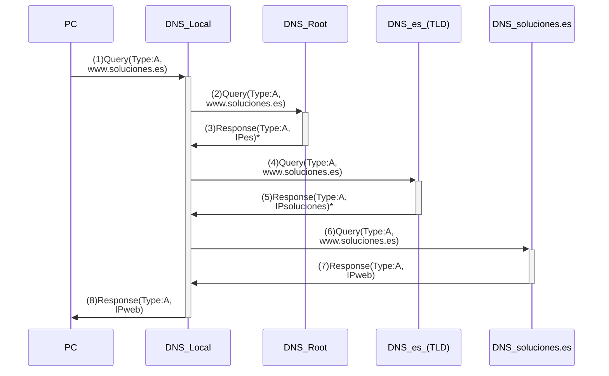

#flashcards/dns 
#review2 

- Example in which a user on a *PC* requests access to the host www.soluciones.es. The *PC* has _Local DNS_ configured as its DNS server, and therefore knows its IP address. In turn, the _Local DNS_ only knows the IP address of a _Root DNS_, which knows that of a _DNS.es_, which finally knows the IP address of the authoritative DNS server of the domain _soluciones.es_. We assume that the _Local DNS_ works in **recursive** mode and the rest of the servers in **iterative** mode.

1. The figure shows how the _PC_ sends the *Local DNS* a query whose _Queries_ section includes a type A RR with name www.soluciones.es.
2. The _Local DNS_ does not have the requested information, so it goes through the different components of the name from right to left (starting with the TLD) and compares them with its own name database (DB). As mentioned, the only information it has in its DB is that of a root server, so it sends a query similar to the one received from the *PC*.
3. The _Root DNS_ receives the query, but does not have the IP address associated with the requested name, so it goes through the name and compares it with the entries in its DB, finding a match with the component *.es*. The _Root DNS_ replies with a DNS message whose *Authoritative Nameservers* section includes a type NS RR with the *Name* field equal to *.es* and the *Name Server* field equal to the name of a DNS server serving the *.es* domain (in our case, *DNS.es*). It also includes in the _Additional Records_ section a type A record with the *Name* field equal to *DNS.es* and the *Address* field set to the IP address associated with that DNS server.
4. The _Local DNS_ stores the information received, and contacts the *.es* TLD server returned by the _Root DNS_ with a query similar to (1) and (2).
5. The *DNS.es* server performs actions similar to those described in step (3) and returns the NS and A records associated with the DNS server *soluciones.es*.
6. After storing the information received, the *Local DNS* contacts the DNS server *soluciones.es*
7. The DNS server *soluciones.es* is an authoritative DNS server for the domain where the requested host is located, so it returns in the *Answers* section a type A RR with the *Name* field equal to www.soluciones.es and the IP address associated with that name in the *Address* field.
8. After storing the information received, the *Local DNS* returns the reply to the PC.

(*) These reply messages include other records, such as type NS records with the names of the DNS servers returned as answers to the queries[^1]. In addition, the messages themselves include type A records that map the IP addresses to the names of the DNS servers mentioned above [^2].

- Question: what would the DNS message exchange be if, right after receiving message (8), the *PC* requests the IP address of the host email.soluciones.es?

[^1]: in the Authoritative Nameservers section
[^2]: in the Additional Records section
