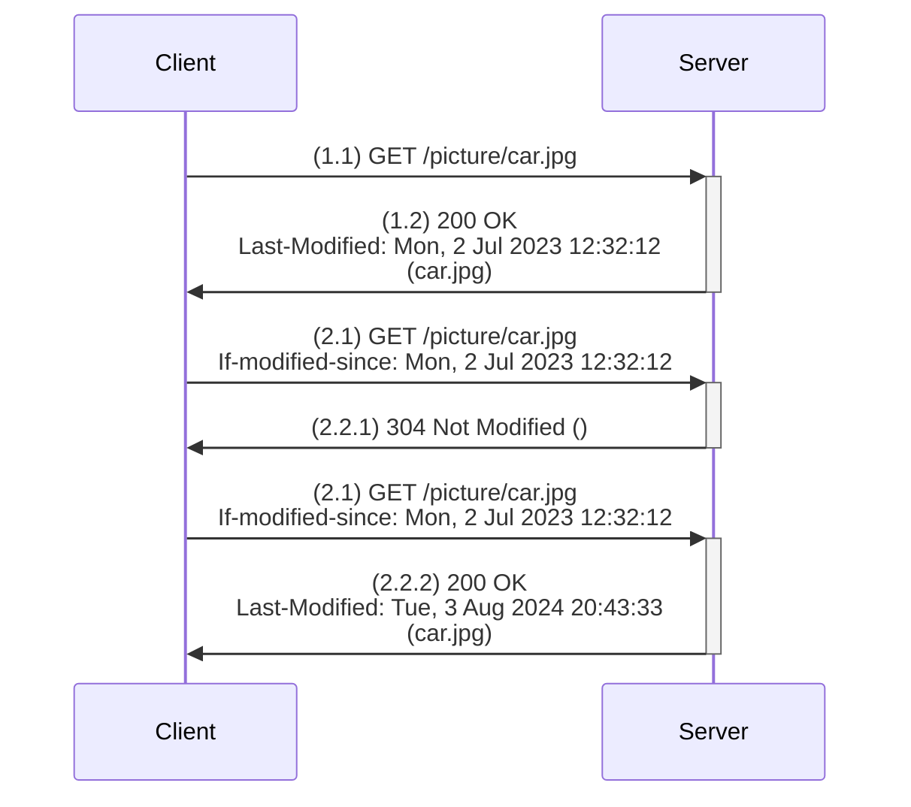

#flashcards/http 
#review2

## 1.  Example when the client does **not** have the [[Web resource]] in its cache
### 1.1 Request message (**normal GET**)
> GET /picture/car.jpg HTTP/1.0
> User-agent: Mozilla/4.0

### 1.2 Response message to the previous request
> HTTP/1.0 200 OK 
> Date: Wed, 4 Aug 2023 16:21:22
> Server: Apache/1.3.0 (Unix)
> Last-Modified: Mon, 2 Jul 2023 12:32:12
> Content-Type: image/jpg
> 
> (.......object content.......)

## 2. Example when the client **does** have the [[Web resource]] in its cache
### 2.1 Request message (conditional GET)
> GET /picture/car.jpg HTTP/1.0
> User-agent: Mozilla/4.0
> If-modified-since: Mon, 2 Jul 2023 12:32:12
### 2.2 There are two possibilities: the object has not been modified, or it has been modified.
#### 2.2.1 Server response when the object has **not** been modified
> HTTP/1.0 304 Not Modified
> Date: Wed, 4 Aug 2023 18:35:11
> Server: Apache/1.3.0 (Unix)
>   
> (....... empty body, no content ........)
#### 2.2.2 Server response when the object **has** been modified
> HTTP/1.0 200 OK 
> Date: Wed, 4 Aug 2023 18:35:11
> Server: Apache/1.3.0 (Unix)
> Last-Modified: Wed, 4 Aug 2023 17:59:43
>
> (....... object content .......)

