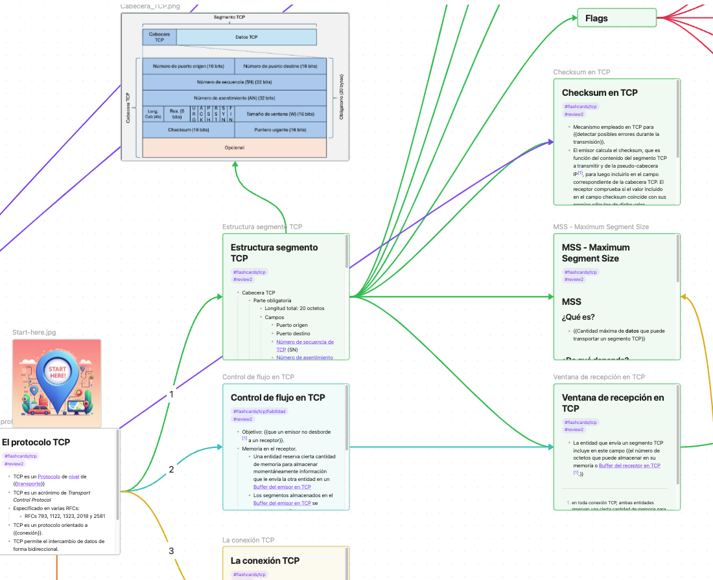

# Augmented Mind Map for Computer Networks Architecture

> **About this translation:** this is an English translation of the original Spanish vault [Mapa Mental Aumentado para Arquitectura de Redes](https://github.com/JaimeGarciaReinoso/MapaMentalAumentadoAR) by Jaime García Reinoso, distributed under the same [CC BY-NC-SA 4.0](https://creativecommons.org/licenses/by-nc-sa/4.0/) license. Notes, folders, canvases and tags have been translated; figures and the linked videos remain in Spanish.

Obsidian vault with notes to follow the courses Arquitectura de Redes I and Arquitectura de Redes (Computer Networks Architecture) at the Universidad de Alcalá. In the following video (in Spanish) you can see how to install and use this Augmented Mind Map: https://youtu.be/P0n3VQC195w?si=qdwPfx607jwX_zTv

You can also find part of the content (in Spanish, and possibly not up to date) at https://mapamentalar1.web.uah.es/

## Installation
- Download and install Obsidian [https://obsidian.md/], a note manager that is free for personal and non-profit use.
- Download the content of the Augmented Mind Map for Computer Networks Architecture I (called a *vault* in Obsidian) from the `english` branch [https://github.com/edelahozuah/MapaMentalAumentadoAR/tree/english]. Click the green *<> Code* button and select *Download ZIP*, or download it with the command *git clone -b english https://github.com/edelahozuah/MapaMentalAumentadoAR.git*
- Once you have unzipped the file, or downloaded it with *git*, open Obsidian and import the *vault* by selecting File -> Open vault. Then select *Open folder as vault* and choose the folder you have just unzipped. Finally, you must trust this *vault*, since it will load some plugins that are described below.
- You can change the language (Settings->General) and the appearance/theme (Settings->Appearance).

## Studying with the Augmented Mind Map
- In Obsidian you will see several folders. Although you can use the notes in the *01-Notes* folder, it is recommended to use the *canvases* in the *02-Canvas* folder.
- Inside the *02-Canvas* folder you will find the *Main* canvas, which contains items linking to the rest of the canvases.
- Always look for the *Start here* icon to know where to start reading in the canvas.
- The arrows connecting the items in the canvases show the suggested reading order.
- To zoom in on a specific card, select it and press "Shift+2". To see all the cards, press "Shift+1".
- Some notes contain text enclosed in double curly braces \{\{\}\}. This means that the content is very important and must be studied carefully. The *Spaced Repetition* plugin uses these double curly braces to review the cards [[README#Reviewing the cards]].

## Reviewing the cards
- The *vault* includes the *Spaced Repetition* plugin, which lets you review the notes you have studied. On the left side of Obsidian you will see an icon that looks like a deck of cards (if you cannot find it, press CMD+P or CTRL+P and search for Spaced Repetition). If you select it, a window with a hierarchical structure will open. Select the deck of questions you want to study/review.
- Once a deck is selected, it will show you notes at random with part of each note hidden, so that you try to recall the correct answer.
- When you want to move on, press the *Show Answer* button. Three buttons will appear so you can rate the question as *Easy*, *Good* or *Hard*. Answer honestly, because this is what lets the algorithm adapt to your knowledge and ask you about what you find hardest to remember.
- There are many options: review only the hard cards, review all of them, etc. You can find more information in the plugin's GitHub repository: https://github.com/st3v3nmw/obsidian-spaced-repetition

## Modification and contribution
- This material is published to serve as a basis for studying the course Arquitectura de Redes I, but you can extend, correct and modify it to suit your way of studying. Have a look at the [[LICENSE|license]] if you want to distribute it or create extended material based on it.
- If you want to contribute to, or report a problem with, the original (Spanish) mind map, you can do so on its GitHub repository: https://github.com/JaimeGarciaReinoso/MapaMentalAumentadoAR

## Help us spread this work
- This project was submitted to the 2024 call for Teaching Innovation Projects of the Universidad de Alcalá and was *not approved*, since the evaluation committee considered that "In the committee's judgment, these activities are not considered to be teaching innovation". Even so, the project has been carried out without UAH support because we believe this augmented mind map is indeed an innovation project. If you also disagree with the committee, I would appreciate it if you sent an email to [ideo@uah.es](mailto:ideo@uah.es) with a text similar to the following:
	- Email subject: Apoyo al proyecto de innovación docente UAH/EV1535 (Support for teaching innovation project UAH/EV1535)
	- Email body: Después de ver el contenido del proyecto "Un Mapa Mental Aumentado para la asignatura Arquitectura de Redes I" con código UAH/EV1535, disponible en https://github.com/JaimeGarciaReinoso/MapaMentalAumentadoAR, y no aprobado en la convocatoria de Proyectos de Innovación Docente 2024 de la Universidad de Alcalá, considero que la comisión se equivocó en su juicio ya que, en mi opinión, este es un proyecto que representa una innovación con respecto al material disponible en la asignatura.
		- (English: After reviewing the content of the project "An Augmented Mind Map for the course Arquitectura de Redes I", code UAH/EV1535, available at https://github.com/JaimeGarciaReinoso/MapaMentalAumentadoAR, which was not approved in the 2024 call for Teaching Innovation Projects of the Universidad de Alcalá, I believe the committee was mistaken in its judgment since, in my opinion, this project represents an innovation with respect to the material available for the course.)
- And of course, share this project with any friends/colleagues/acquaintances who may find it useful!!!
